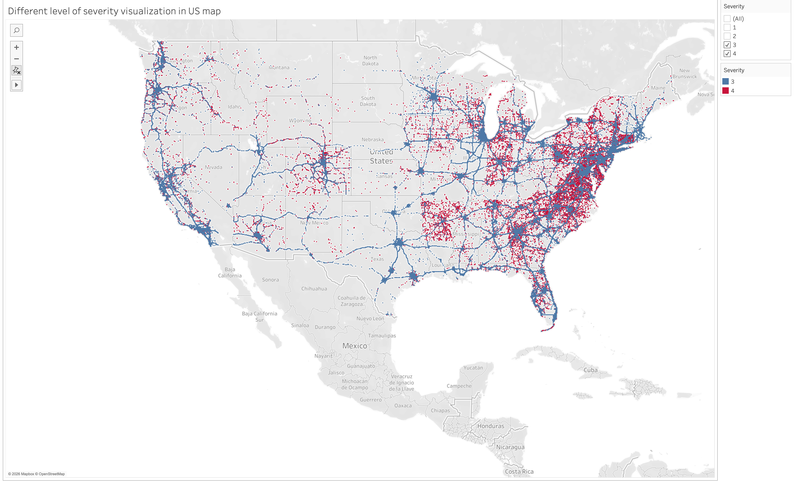
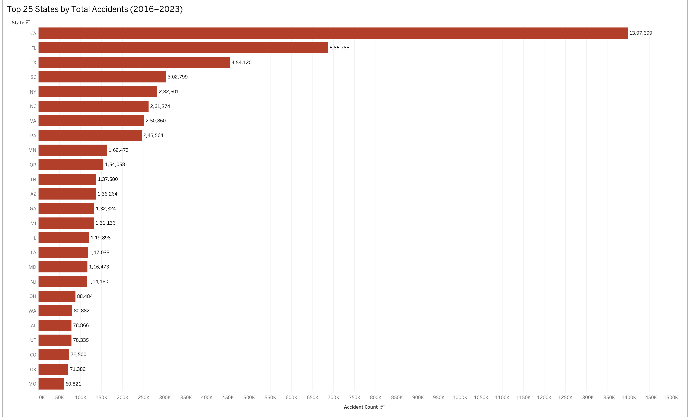
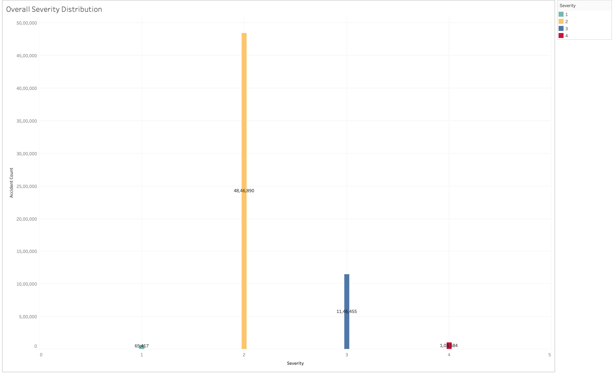
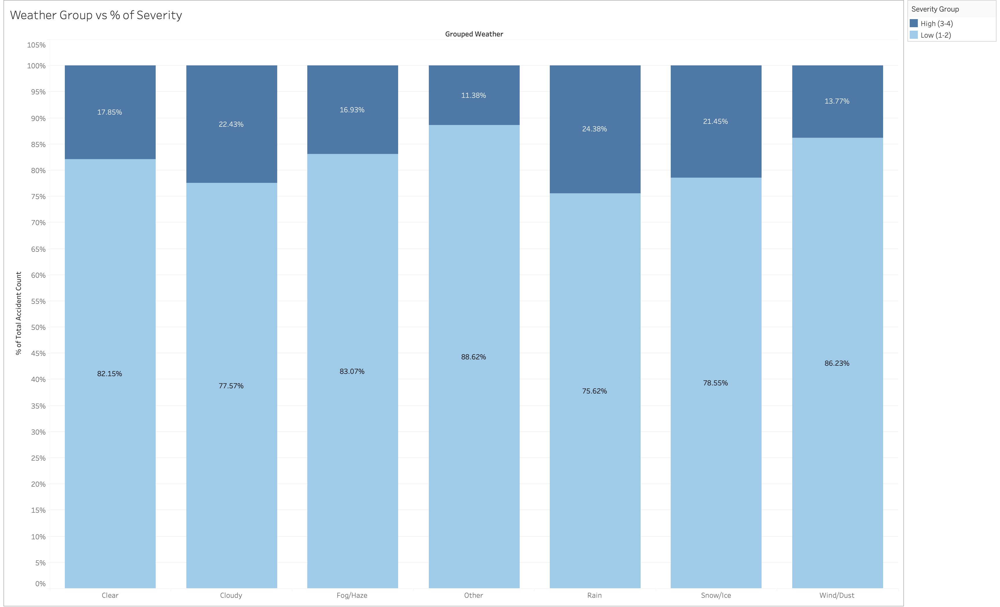
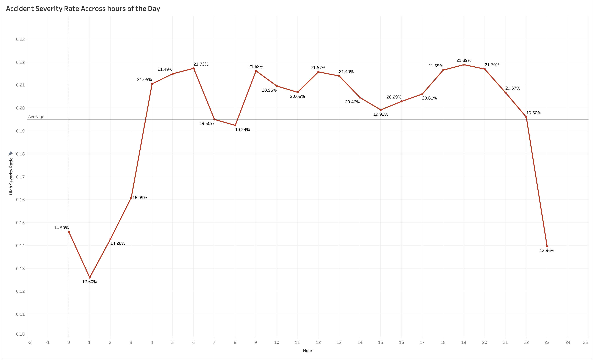
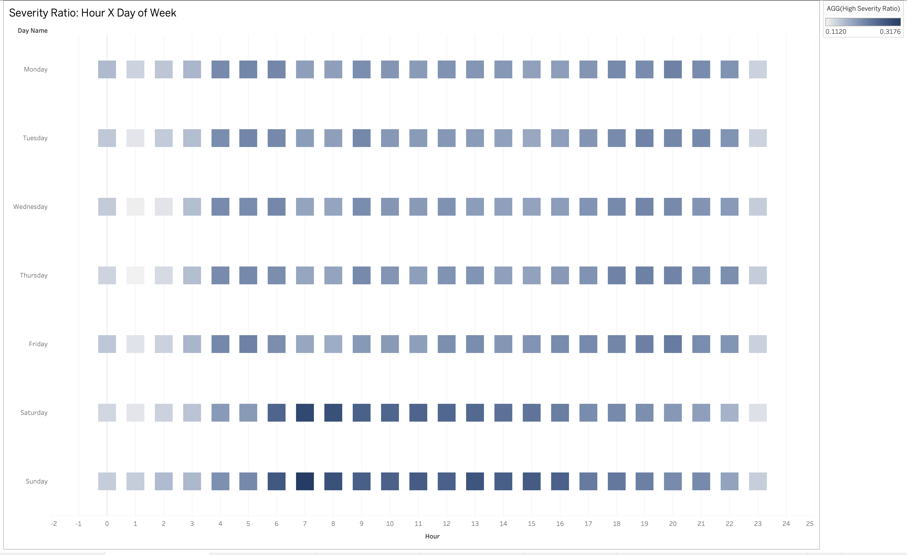

# US Traffic Accident Severity Analysis

> **DS612 – Interactive Data Visualisation · Group 7**  
> A hypothesis-driven visual analysis of 7.7 million US accident records (2016–2023)

---

## Overview

This project investigates **what drives accident severity across the United States**, using the [US Accidents dataset (Kaggle)](https://www.kaggle.com/datasets/sobhanmoosavi/us-accidents) — one of the largest publicly available traffic accident datasets, covering 49 states from 2016 to 2023.

> ⚠️ **Key insight:** The dataset's "severity" metric measures **traffic flow disruption** (scale 1–4), not physical injury severity. This distinction fundamentally shapes every analysis and conclusion in this project.

---

## Hypotheses Investigated

| # | Hypothesis | Verdict |
|---|-----------|---------|
| H1 | Adverse weather conditions increase accident severity | ✅ Partially supported — rain raises severity, but snow/ice do *not* |
| H2 | Rush hours increase accident frequency and severity | ✅ Supported — AM/PM peaks confirmed with nuance |
| H3 | Extreme weather shows a statistical severity gap | ✅ Rain vs. clear weather gap statistically significant |
| H4 | Severity plateau occurs in early morning hours (3–6 AM) | ✅ Confirmed, with Saturday as an outlier peak |

---

## Visualizations

**Geographic Distribution of Accidents**


**Top 25 States by Accident Count**


**Severity Distribution**


**Weather Conditions vs. Severity (Stacked)**


**Hourly Accident Rate by Severity**


**Hour × Day-of-Week Heatmap**


---

## Interactive Dashboard

🔗 **[View Interactive Dashboard on Tableau Public →](https://public.tableau.com/app/profile/aditya.jana5198/viz/us-traffic-accident-severity-analysis)**

To explore locally: open `US accident.twbx` in **Tableau Desktop** or the free [Tableau Reader](https://www.tableau.com/products/reader).

---

## Data Source

**Dataset:** [US Accidents (2016–2023)](https://www.kaggle.com/datasets/sobhanmoosavi/us-accidents) by Sobhan Moosavi et al.  
**Size:** ~7.7 million records, 47 features  
**Not included in this repo** due to size. Download directly from Kaggle and place as `data/US_Accidents_March23.csv`.

---

## Repository Structure

```
├── notebooks/
│   ├── data_preprocessing.ipynb   # Data cleaning, sampling, feature engineering
│   └── analysis.ipynb             # All hypothesis-driven visualizations (Python/matplotlib)
├── reports/
│   └── Final_Report.pdf           # 35-page formal project report
├── presentation/
│   ├── Slides.pptx                # Final presentation slides (10 slides)
│   └── Speaker_Script.md          # Full speaker notes (~30 min)
├── latex/                         # LaTeX source for the report (compilable via Overleaf)
│   ├── main.tex
│   ├── sections/                  # Modular section files (14 sections)
│   └── figures/                   # All visualization PNGs
└── _archive/                      # Draft versions (not tracked by Git)
```

---

## How to Reproduce

1. **Download the dataset** from [Kaggle](https://www.kaggle.com/datasets/sobhanmoosavi/us-accidents)
2. Run `notebooks/data_preprocessing.ipynb` to clean and sample the data
3. Run `notebooks/analysis.ipynb` to reproduce all visualizations
4. Open `reports/Final_Report.pdf` for the full written analysis

---

## Team

| Name | Student ID |
|------|-----------|
| Dhruv Parmar | 202518030 |
| Aditya Jana | 202518035 |
| Mahak Khurdia | 202518039 |
| Falak Parmar | 202518053 |

---

## References

- Moosavi, S. et al. (2019). *A Countrywide Traffic Accident Dataset*. arXiv:1906.05409
- Moosavi, S. et al. (2019). *Accident Risk Prediction based on Heterogeneous Sparse Data*. ACM SIGSPATIAL
